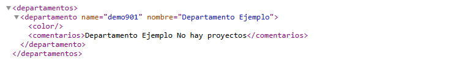

# Portal de inscripciones e informes educativos
[English](#english) · [Español](#español)

## English

Archived ASP.NET portal for recording education applications and producing institutional reports

> [!WARNING]
> **Status: archived.** Source from 2006–2008. This edition precompiled with .NET Framework 4.8.

### Overview

The portal stores forms and reference lists for education applications. Operators enter records. Reviewers use the application and reporting pages to follow decisions and consult institutions. The available screens vary by edition.

### Features

- Enter a school’s application and check its institution in [Inscripción](inscripcion/inscripcion/inscripcion.aspx).
- Review project applications and record the approval decision in [Aprobación](aprobacion/proyectos/aprobacion.aspx).
- Review the feasibility information for a project in [Viabilización](viabilizacion/proyectos/viabilizacion.aspx).
- Look up a project for follow-up in [Seguimiento](seguimiento/proyectos/proyecto.aspx).
- Open the project photo gallery in [Galería](fotos/proyectos/galeria.aspx).

### Requirements

| Component | Version | Purpose |
| --- | --- | --- |
| ASP.NET precompiler | 4.8.10001.0 | Compiles the Web Forms pages |
| IIS Express | 10.0.26013.1000 | Runs the verification site |
| SQL Server Developer | 2022 | Stores the fictional catalogue |
| Anthem.NET | 1.3.1.0 | Supports the original page controls |

### Getting started

Run `docker compose -f demo/compose.yaml up -d --pull never` with `PORTAL_DEMO_SA_PASSWORD` set to a newly generated test password in your terminal. The SQL Server 2022 Developer image must already be available locally. Use `127.0.0.1,11433` in the generated configuration. Change the loopback port with `PORTAL_DEMO_PORT` if needed. Run `docker compose -f demo/compose.yaml down -v` to delete the demo database when finished.

From a Windows checkout, run `pwsh -NoProfile -File demo/Build.ps1 -Output <new-folder>`. Serve the resulting `site` folder with IIS Express on `127.0.0.1`. Load [the fictional schema](demo/schema.sql) into a disposable SQL Server instance bound to `127.0.0.1`. Add `servidor`, `db`, `usuario` and `contrasena` to `appSettings` in the generated site configuration. Point them to that instance, the `portal_demo` database and a new test user.

### Usage

To try the registration and institution report filters, start a fresh local SQL Server container. Run [the extended fictional data script](demo/PortalFlows.sql) with `sqlcmd` and set `FictionalSqlPassword` and `FictionalPortalPassword` to two new local test values. Use the first in `contrasena` in the generated site configuration. Sign in as `alicia_demo` with the second. In the registration form, verify institution `INST-EJEMPLO-701`. In the institution report, search using the same code.

To reproduce sign-in, map a fictional SQL login to a database user named `portal_demo_user`. Run [the sign-in fixture](demo/PortalLogin.sql) with `sqlcmd` and the variable `FictionalPortalPassword` set to a new fictional password. Open `Default.aspx` and sign in as `alicia_demo` using that password. The application records the sign-in and opens an entry menu with the fictional catalogue link.

Copy `demo/CatalogProbe.aspx.example` into the test site as `prueba-catalogo.aspx`. Open that page in the local site. The fictional record is Departamento Ejemplo. The initializer opens the original `datosmapa.aspx` page and that page returns the record as XML.

### Project structure

- `estilos/` · Stylesheets and small image assets used by the restored pages.
- `aplicativo/`. Institutional catalogues. Open the school list in `aplicativo/institucion/ieducativas.aspx`.
- `App_Code/`. Shared record and data access classes. Start with `App_Code/CMapa.cs`.
- `aprobacion/`. Agreement and project decisions, including proyectos/aprobacion.aspx.
- `ayuda/`. Common help layout in ayuda.master.
- `bin/` · Original Anthem.NET assembly
- `demo/` · Build and fictional SQL scenario
- `demos/`. Example catalogue query in ejemplo.json.
- `fotos/`. Project photos and gallery entry points under proyectos/.
- `imagenes/`. Menu banners, navigation icons and LogoEntidad.aspx.
- `importar/`. File import handler in archivos/Default.aspx.cs.
- `informes/` · Report pages
- `inscripcion/` · Application forms
- `menu/`. JSCookMenu.js and the visual theme for the menu.
- `scripts/`. Common browser helpers, including comun.js.
- `seguimiento/`. Follow-up pages for projects and agreements, including proyectos/proyecto.aspx.
- `sistema/`. Administrative catalogues and user groups. Start at `sistema/usuarios/grupos.aspx`.
- `viabilizacion/`. Project feasibility entry in proyectos/viabilizacion.aspx.
- `docs/` · Evidence from the fictional verification

### Verification

Docker Compose 5.6.1 starts the disposable service in this verification.

Windows build 10.0.26300, IIS Express 10.0.26013.1000 (WinBuild.160101.0800), SQL Server 16.0.4325.4 and .NET Framework ASP.NET Compiler 4.8.10001.0.

Verified on 20 November 2026. The portal was built in Windows and tested with IIS Express and a disposable SQL Server instance. The catalogue query and sign-in passed. SQL Server recorded the sign-in and the menu showed the fictional link. The registration institution lookup and institution report search returned the fictional row. Saving an entire application and generating the other reports remain to be exercised.

### History

The archive follows portal development from 2006 to 2008, including applications, agreements and reports. The 2026 work adds the bilingual build guide, two separately recovered editions and a fictional local trial.

### Support

Use an issue with the commit and the fictional reproduction steps.

### Contributing

We welcome reproducibility fixes. Include the edition, exact build command, tools and a fictional example when proposing a change.

### License

The original application is available under the [MIT license](LICENSE).

---

## Español

Archivado — portal ASP.NET para registrar inscripciones educativas y preparar informes de instituciones

> [!WARNING]
> **Estado: archivado.** Código de 2006 a 2008. Esta edición precompiló con .NET Framework 4.8.

### Descripción general

El portal reúne formularios y catálogos para gestionar inscripciones educativas. El personal registra solicitudes y usa las páginas de revisión e informes para seguir decisiones y consultar instituciones. Las pantallas disponibles dependen de la edición.

### Funciones

- Registra la solicitud y verifica su institución en [Inscripción](inscripcion/inscripcion/inscripcion.aspx).
- Revisa las solicitudes y registra la aprobación en [Aprobación](aprobacion/proyectos/aprobacion.aspx).
- Revisa la viabilidad de un proyecto en [Viabilización](viabilizacion/proyectos/viabilizacion.aspx).
- Consulta un proyecto para hacer seguimiento en [Seguimiento](seguimiento/proyectos/proyecto.aspx).
- Abre la galería fotográfica del proyecto en [Galería](fotos/proyectos/galeria.aspx).

### Requisitos

| Componente | Versión | Función |
| --- | --- | --- |
| Precompilador ASP.NET | 4.8.10001.0 | Compila las páginas Web Forms |
| IIS Express | 10.0.26013.1000 | Ejecuta el sitio de prueba |
| SQL Server Developer | 2022 | Guarda el catálogo ficticio |
| Anthem.NET | 1.3.1.0 | Permite usar los controles originales de las páginas |

### Cómo empezar

Ejecuta `docker compose -f demo/compose.yaml up -d --pull never` con `PORTAL_DEMO_SA_PASSWORD` definida en tu terminal con una contraseña nueva de prueba. La imagen SQL Server 2022 Developer debe estar disponible localmente. Usa `127.0.0.1,11433` en la configuración generada. Si necesitas otro puerto local, defínelo en `PORTAL_DEMO_PORT`. Al terminar, ejecuta `docker compose -f demo/compose.yaml down -v` para borrar la base de prueba.

Desde una copia en Windows, ejecuta `pwsh -NoProfile -File demo/Build.ps1 -Output <new-folder>`. Abre la carpeta `site` resultante con IIS Express en `127.0.0.1`. Carga [el esquema ficticio](demo/schema.sql) en una instancia desechable de SQL Server enlazada a `127.0.0.1`. Agrega `servidor`, `db`, `usuario` y `contrasena` a `appSettings` en la configuración generada del sitio. Indica esa instancia, la base `portal_demo` y un usuario nuevo de prueba.

### Uso

Para probar los filtros de inscripción e informes de instituciones, inicia un SQL Server local nuevo. Ejecuta [el escenario ficticio ampliado](demo/PortalFlows.sql) con `sqlcmd` y define `FictionalSqlPassword` y `FictionalPortalPassword` con dos valores nuevos de prueba. Usa el primero en `contrasena` en la configuración generada. Ingresa como `alicia_demo` con el segundo. En el formulario de inscripción, verifica la institución `INST-EJEMPLO-701`. En el informe, busca con el mismo código.

Para reproducir el ingreso, asigna un login ficticio de SQL a un usuario de la base llamado `portal_demo_user`. Ejecuta [el escenario de ingreso](demo/PortalLogin.sql) con `sqlcmd` y define la variable `FictionalPortalPassword` con una contraseña ficticia nueva. Abre `Default.aspx` e ingresa como `alicia_demo` con esa contraseña. La aplicación registra el ingreso y abre el menú de entrada con el enlace al catálogo ficticio.

Copia `demo/CatalogProbe.aspx.example` al sitio de prueba como `prueba-catalogo.aspx`. Abre esa página en el sitio local. El registro ficticio se llama Departamento Ejemplo. El inicializador abre la página original `datosmapa.aspx` y esa página devuelve el registro en XML.

### Estructura del proyecto

- `estilos/` · Hojas de estilo y pequeños recursos gráficos de las páginas recuperadas.
- `aplicativo/`. Catálogos institucionales. Abre la lista de escuelas en `aplicativo/institucion/ieducativas.aspx`.
- `App_Code/`. Clases compartidas y de acceso a datos. Consulta `App_Code/CMapa.cs`.
- `aprobacion/`. Decisiones de convenios y proyectos, incluida proyectos/aprobacion.aspx.
- `ayuda/`. Plantilla compartida de ayuda en ayuda.master.
- `bin/` · Ensamblado original de Anthem.NET
- `demo/` · Compilación y escenario ficticio en SQL
- `demos/`. Consulta de catálogo de ejemplo en ejemplo.json.
- `fotos/`. Fotos y páginas de galería de proyectos en proyectos/.
- `imagenes/`. Encabezados del menú, iconos y LogoEntidad.aspx.
- `importar/`. Manejador de importación en archivos/Default.aspx.cs.
- `informes/` · Páginas de informes
- `inscripcion/` · Formularios de inscripción
- `menu/`. JSCookMenu.js y el tema visual del menú.
- `scripts/`. Funciones de navegador compartidas, incluida comun.js.
- `seguimiento/`. Seguimiento de proyectos y convenios, incluido proyectos/proyecto.aspx.
- `sistema/`. Catálogos administrativos y grupos de usuarios. Empieza en `sistema/usuarios/grupos.aspx`.
- `viabilizacion/`. Ficha de viabilidad de proyectos en proyectos/viabilizacion.aspx.
- `docs/` · Evidencia de la comprobación ficticia

### Verificación

Docker Compose 5.6.1 inicia el servicio desechable de esta verificación.

Windows compilación 10.0.26300, IIS Express 10.0.26013.1000 (WinBuild.160101.0800), SQL Server 16.0.4325.4 y compilador ASP.NET de .NET Framework 4.8.10001.0.

Verificado el 20 de noviembre de 2026. El portal se compiló en Windows y se probó con IIS Express y una instancia desechable de SQL Server. Pasaron la consulta del catálogo y el ingreso. SQL Server registró el ingreso y el menú mostró el enlace ficticio. La búsqueda de la institución en la inscripción y el filtro del informe devolvieron el registro ficticio. Falta guardar una solicitud completa y probar los demás informes.

### Historia

El archivo sigue el desarrollo del portal de 2006 a 2008, con inscripción, convenios e informes. En 2026 se agregaron la guía bilingüe, dos ediciones recuperadas por separado y una prueba local ficticia.

### Soporte

Abre una incidencia con el commit y el procedimiento con datos ficticios.

### Contribuir

El archivo conserva las ediciones de código como referencia.

### Licencia

La aplicación original se distribuye con [licencia MIT](LICENSE).
